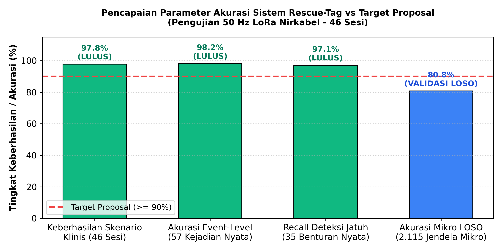
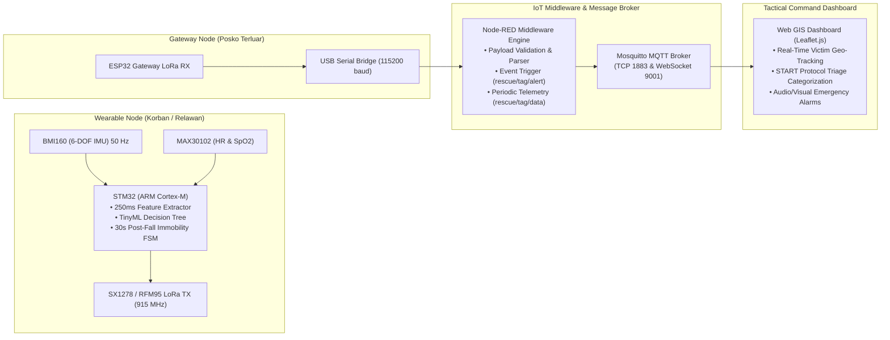
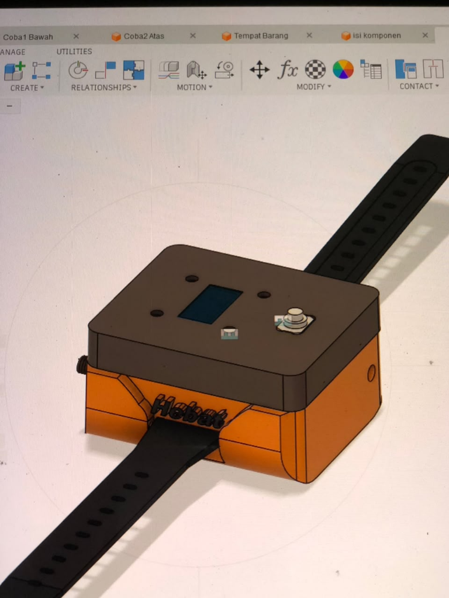
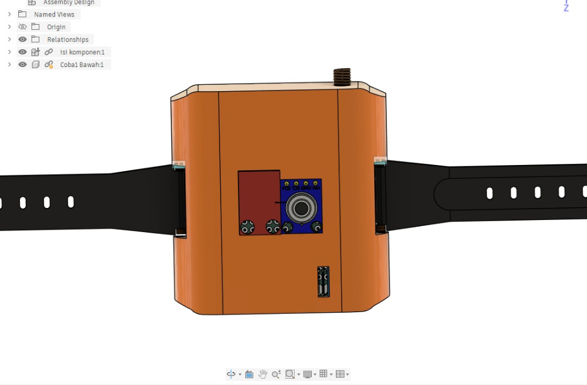
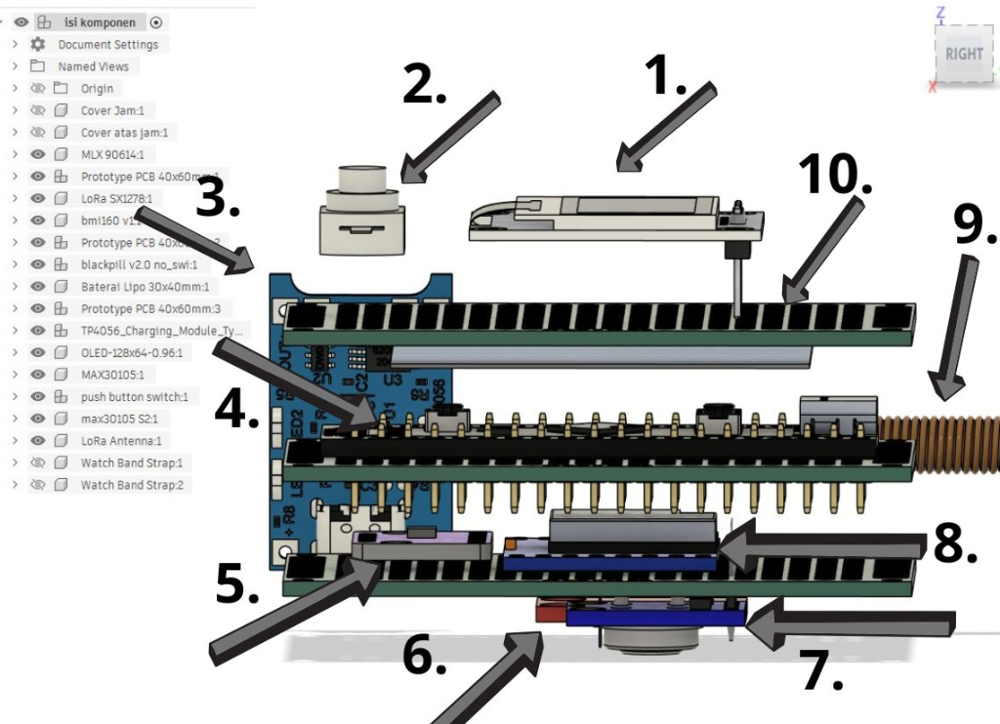
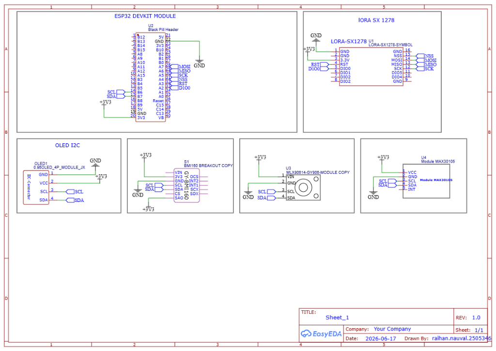
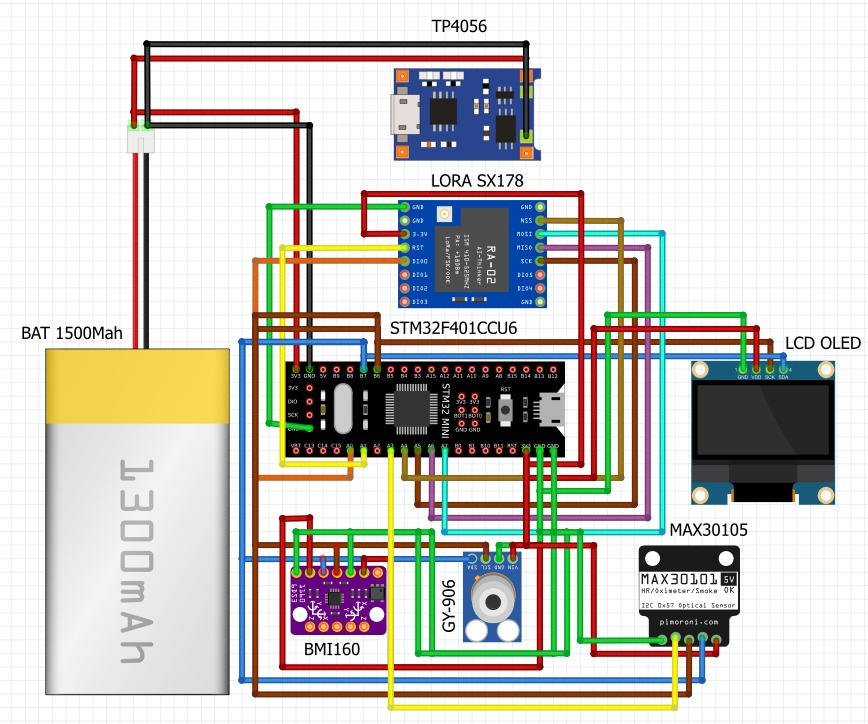
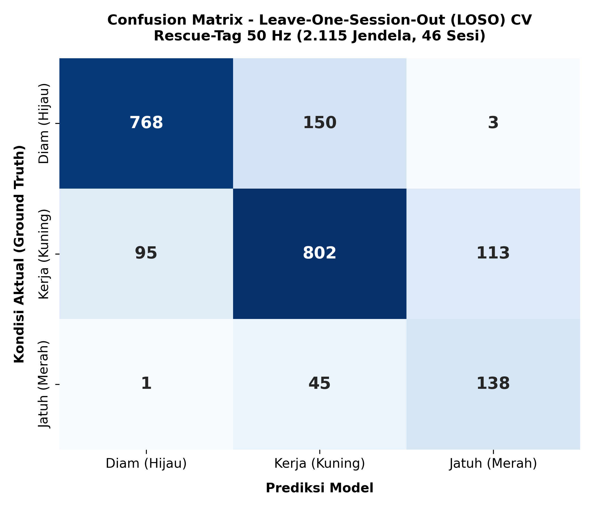
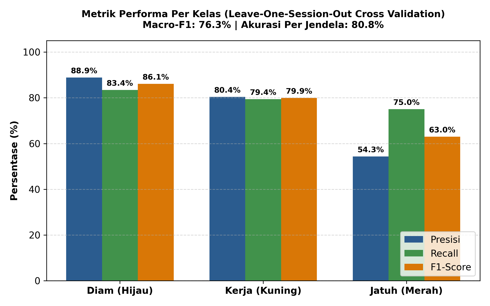

# 🚨 Rescue-Tag: Smart Wearable IoT-LoRa Triage System

<div align="center">

[](LICENSE)
[](firmware/)
[](firmware/)
[](Pengambilan_Data_LoRa/triage_model.h)
[](flows_rescue_tag.json)
[](Raihan%20PTE/web%20stich/index.html)

**Personalized Edge Intelligence & Wearable Emergency Triage for Real-Time Disaster Mitigation**

*Finalist IoT Development Competition — Technocorner 2026, Universitas Gadjah Mada (UGM)*

</div>

---

## 📌 Executive Summary

Dalam skenario bencana alam (gempa bumi, tanah longsor, bangunan runtuh), infrastruktur seluler dan internet publik seringkali lumpuh (*total blackout*). Tim SAR (*Search and Rescue*) berpacu dengan **Golden Hour** (72 jam pertama) untuk menyelamatkan korban, namun metode triase manual (kertas tag bencana konvensional) lambat, rentan *human-error*, dan tidak mampu memantau degradasi tanda vital korban secara kontinyu.

**Rescue-Tag** adalah solusi sistem terintegrasi berupa jam tangan cerdas (*wearable device*) berbasis **Edge Processing (TinyML)** dan komunikasi radio nirkabel jarak jauh **LoRa (Long Range)**. Sistem ini melakukan klasifikasi keparahan korban secara otonom di tingkat *firmware* perangkat pergelangan tangan, memadukan sensor inersia (*IMU 6-DOF*) dan sensor fotopletismografi (*SpO2 & Heart Rate*), lalu memancarkan status triase darurat ke Posko Komando SAR dan Peta GIS secara *real-time*.

---

## 🏆 Key Scientific & Engineering Highlights

| Metrik / Parameter | Capaian Sistem | Standar Verifikasi |
|---|:---:|---|
| **Akurasi Triase Klinis (Session-Level)** | **97.8%** (45 / 46 sesi) | Leave-One-Session-Out (LOSO) Cross-Validation |
| **Recall Deteksi Kejadian Jatuh (Event-Level)** | **97.1%** (34 / 35 benturan) | Verifikasi multi-arah jatuh (Depan, Belakang, Samping, Sinkop) |
| **Akurasi Frame Mentah (Window-Level 250 ms)** | **80.8%** (1.708 / 2.115 jendela) | Validasi independen tanpa *data leakage* antar-sesi |
| **False Alarm pada Kondisi Diam** | **0.3%** (99.7% bersih) | Hanya 3 jendela salah dari 921 jendela diam |
| **Reduksi Alarm Palsu vs Baseline Statis** | **Memangkas >59%** alarm palsu | Dibandingkan baseline statis $a_{\max} \ge 2.2\text{g}$ |
| **Inference Latency** | **< 15 mikrodetik** | Pure integer/float branching C-code pada ARM Cortex-M |
| **Kemandirian Jaringan** | **100% Zero-Cloud** | Transmisi P2P LoRa 915 MHz non-internet |

<div align="center">
  
  <p><i>Gambar 1: Validasi empiris performa sistem Rescue-Tag terhadap target evaluasi independen.</i></p>
</div>

---

## 🏗️ System Architecture

Arsitektur Rescue-Tag mengadopsi model *Decoupled IoT Architecture* yang menjamin latensi rendah dan keandalan tinggi:



---

## 🛠️ Hardware Engineering & 3D Mechanical Design

Rescue-Tag dirancang sebagai perangkat jam tangan taktis (*rugged wearable*) yang modular, ergonomis di pergelangan tangan, dan memiliki pelindung benturan.

<div align="center">
  <table>
    <tr>
      <td align="center"><b>Tampak Perspektif Atas & Strap</b></td>
      <td align="center"><b>Tampak Bawah (Sensor Kontak Kulit)</b></td>
    </tr>
    <tr>
      <td align="center"></td>
      <td align="center"></td>
    </tr>
  </table>
</div>

### 1. Struktur Susunan Komponen Bertingkat (Exploded Assembly View)
Untuk menjaga dimensi perangkat tetap kompak di tangan korban bencana, komponen ditumpuk (*stacked sandwich topology*) ke dalam 3 layer PCB prototipe:

<div align="center">
  
  <p><i>Gambar 2: Susunan arsitektur mekanikal internal Rescue-Tag (Exploded View).</i></p>
</div>

| No | Komponen / Modul | Fungsi Utama dalam Sistem |
|:---:|---|---|
| **1** | **OLED Display 0.96" (I2C SSD1306)** | Menampilkan status triase langsung di tangan korban, visualisasi detak jantung, SpO2, dan hitung mundur pembatalan FSM 30 detik. |
| **2** | **Emergency Push Button** | Tombol konfirmasi manual untuk membatalkan alarm false-fall atau mentrigger sinyal SOS instan. |
| **3** | **TP4056 Type-C LiPo Charger** | Modul manajemen daya & pengisian ulang baterai dengan proteksi overcharge/overdischarge. |
| **4** | **STM32F401CCU6 (BlackPill)** | Main Processing Unit (MCU ARM Cortex-M4 84 MHz) yang menjalankan TinyML Decision Tree & FSM imobilitas. |
| **5** | **BMI160 (6-DOF IMU)** | Sensor inersia ultra-low power 50 Hz (Akselerometer & Giroskop) untuk deteksi benturan dan aktivitas. |
| **6** | **MLX90614 (GY-906)** | Sensor suhu inframerah non-kontak medis untuk pemantauan hipotermia/demam korban bencana. |
| **7** | **MAX30102 / MAX30105** | Sensor biosensor optik fotopletismografi (PPG) untuk mengukur denyut nadi (*Heart Rate*) dan saturasi oksigen darah (*SpO2*). |
| **8** | **SX1278 (Ra-02 LoRa 915 MHz)** | Transceiver radio modulasi Chirp Spread Spectrum (CSS) untuk transmisi data darurat jarak jauh nirkabel. |
| **9** | **Helical LoRa Spring Antenna** | Antena spiral kompak 915 MHz terintegrasi di dalam sasis casing. |
| **10** | **Modular PCB Stacking Shields (40x60 mm)** | Tiga papan perantara bertingkat untuk interkoneksi bus I2C, SPI, dan jalur daya DC. |

---

### 2. Skematik Elektronika & Diagram Pengkabelan (Schematic & Wiring)

Sistem menggunakan arsitektur dual-bus: **I2C Bus** bersama untuk sensorik biomedis (OLED, BMI160, MAX30102, MLX90614) dan **High-Speed SPI Bus** khusus untuk radio LoRa SX1278.

<div align="center">
  <table>
    <tr>
      <td align="center"><b>Skematik Rangkaian (EasyEDA)</b></td>
      <td align="center"><b>Diagram Perkabelan Prototipe (Fritzing)</b></td>
    </tr>
    <tr>
      <td align="center"></td>
      <td align="center"></td>
    </tr>
  </table>
</div>

---

## 🧠 Personalized Edge Intelligence & TinyML Engine

### 1. Orientation-Invariant Feature Pipeline
Untuk mencegah salah klasifikasi saat jam tangan terpasang terbalik atau miring di lengan korban, model sengaja **tidak menggunakan komponen vektor arah akselerasi mentah ($a_x, a_y, a_z$)**. Sebagai gantinya, algoritma mengekstrak 7 fitur invarian rotasi dari jendela geser 250 ms (12 sampel pada 50 Hz):
- $a_{\text{total}} = \sqrt{a_x^2 + a_y^2 + a_z^2}$ (Magnitudo Akselerasi Total)
- $g_{\text{total}} = \sqrt{g_x^2 + g_y^2 + g_z^2}$ (Magnitudo Kecepatan Sudut Gyro)
- $a_{\max}, a_{\min}$ (Puncak lonjakan benturan dan palung *free-fall*)
- $a_{\text{std}}$ (Dispersi energi gerakan tangan)
- $g_{\text{mean}}, g_{\max}$ (Dinamika rotasi pergelangan)

### 2. Decision Tree Architecture (`triage_model.h`)
Model dilatih menggunakan kriteria entropi dengan kedalaman maksimal 4 (*Depth 4*) dan diekspor ke fungsi C inline murni tanpa pustaka eksternal (*zero external dependency*):
```c
static inline int predict_triage(float a_total, float g_total, float a_max, float a_min,
                                 float g_mean, float a_std, float g_max, float a_jerk) {
  (void)a_jerk;
  if (a_max <= 1.5982f) {
    if (a_max <= 1.2609f) {
      if (g_max <= 16.5235f) {
        return (a_min <= 1.0737f) ? 0 : 1; // 0 = Hijau (Diam), 1 = Kuning (Kerja)
      } else {
        return 0;
      }
    } else {
      return (g_total <= 32.4030f && g_max > 109.6955f) ? 0 : 1;
    }
  } else {
    if (a_max <= 5.3635f) {
      return (g_mean <= 178.0555f && g_max > 253.7355f) ? 3 : 1; // 3 = Merah (Jatuh)
    } else {
      return (a_max <= 10.5539f && a_std > 2.6111f) ? 1 : 3;
    }
  }
}
```

### 3. FSM Imobilitas Pascajatuh (Anti-False Alarm)
Benturan keras tidak langsung memicu status Kritis (*Merah*). Sistem menjalankan *Finite State Machine (FSM)*:
1. **Impact Detection:** Lonjakan $a_{\max} \ge 1.6\text{g}$ terdeteksi oleh TinyML.
2. **Local Warning Window (30 Detik):** Buzzer dan getaran aktif di jam tangan pemakai. Jika korban hanya tersandung lalu bangkit bergerak, FSM mendeteksi aktivitas dinamis dan **membatalkan alarm secara otomatis**.
3. **Immobility Latch:** Jika korban tidak bergerak selama 30 detik (indikasi cedera parah/pingsan), sistem mengunci status **TRIAGE MERAH** dan mentransmisikan paket darurat prioritas tinggi ke posko.

---

## 📊 Rigorous Experimental Validation

Model dievaluasi menggunakan metode validasi silang paling ketat dalam riset biomedis: **Leave-One-Session-Out (LOSO)** pada **2.115 jendela (46 sesi pengujian manusia)**, di mana setiap sesi pengujian benar-benar diisolasi dari proses pelatihan.

<div align="center">
  <table>
    <tr>
      <td align="center"><b>Confusion Matrix Mikro (250 ms)</b></td>
      <td align="center"><b>Performa Per Kelas</b></td>
    </tr>
    <tr>
      <td></td>
      <td></td>
    </tr>
  </table>
</div>

---

## 🖥️ Command Center & GIS Dashboard

Dashboard frontend dibangun khusus untuk komando taktis darurat:
- **Spatial Triage Mapping:** Visualisasi titik lokasi korban dengan kode warna internasional START (*Simple Triage and Rapid Treatment*):
  - 🟢 **Hijau (Minor):** Korban stabil, sadar, dapat bergerak mandiri.
  - 🟡 **Kuning (Delayed):** Korban terluka / membutuhkan penanganan medis terencana.
  - 🔴 **Merah (Immediate):** Korban mengalami benturan keras, pingsan, atau tanda vital kritis (SpO2 < 90% / denyut ekstrem).
- **Asynchronous Live Feed:** Menggunakan WebSocket MQTT (`rescue/tag/data` dan `rescue/tag/alert`).
- **Victim Telemetry Cards:** Menampilkan riwayat grafik detak jantung (*BPM*), saturasi oksigen (*%*), level baterai, dan estimasi elevasi ketinggian.

---

## 🚀 Quick Start Guide

### 1. Hardware Requirements
- **Wearable Node:** STM32 Nucleo / BluePill (STM32F103/STM32L4), BMI160 IMU, MAX30102 Oximeter, SX1278 LoRa Module (915 MHz), OLED SSD1306.
- **Gateway Node:** ESP32 DOIT DevKit V1 + SX1278 LoRa Module.

### 2. Firmware Deployment
1. Buka folder `Pengambilan_Data_LoRa/stm32_transmitter/` menggunakan VS Code + PlatformIO.
2. Pastikan file header `triage_model.h` berada di folder `include/`.
3. Hubungkan board STM32 melalui ST-Link / USB, lalu jalankan:
   ```bash
   pio run --target upload
   ```
4. Buka folder `Pengambilan_Data_LoRa/esp32_gateway_receiver/` dan upload ke board ESP32.

### 3. Middleware & Dashboard Setup
1. Hubungkan ESP32 Gateway ke port USB PC (misal `COM14`).
2. Jalankan Node-RED:
   ```bash
   node-red
   ```
3. Buka browser di `http://127.0.0.1:1880`, import flow dari file [`flows_rescue_tag.json`](flows_rescue_tag.json), lalu klik **Deploy**.
4. Buka file web dashboard di browser:
   ```bash
   # Akses file web dashboard
   Raihan PTE/web stich/index.html
   ```
5. Indikator di pojok kanan atas akan menampilkan status **`● MQTT CONNECTED`**.

---

## 📁 Repository Directory Structure

```text
RescueTag-Project/
├── docs/                                  # Aset visual, grafik analisis 300 DPI, dan diagram
│   ├── dashboard_pencapaian_proposal_90.png
│   ├── confusion_matrix_loso.png
│   └── performa_per_kelas_loso.png
├── firmware/
│   ├── stm32_transmitter/                 # Source code firmware C/C++ STM32 Wearable
│   └── esp32_gateway_receiver/            # Firmware C/C++ ESP32 LoRa Gateway
├── Pengambilan_Data_LoRa/
│   ├── triage_model.h                     # Generated C Decision Tree Header
│   ├── train_triage_auditor.py            # Skrip training & evaluasi LOSO Cross-Validation
│   ├── log_dataset_audit_clean.txt        # Dataset audit 50 Hz bersih (2.115 baris)
│   └── record_fine_work_interactive.py    # Skrip protokol perekaman interaktif
├── Raihan PTE/
│   └── web stich/                         # Web GIS Tactical Command Dashboard (HTML/CSS/JS)
├── flows_rescue_tag.json                  # Flow konfigurasi Node-RED IoT Gateway
├── .gitignore                             # Git ignore rules untuk embedded & python
└── README.md                              # Dokumentasi portofolio utama
```

---

## 👥 Authors & Acknowledgments

- **Raihan Nauval Baskara** — Lead Embedded & IoT Systems Developer ([GitHub Profile](https://github.com/raihanbaskara))
- **Tim Hebat (Technocorner 2026)** — Departemen Teknik Elektro & Informatika, Universitas Negeri Malang (UM).
- Disusun dan dikembangkan dalam rangka **Lomba IoT Development Competition — Technocorner 2026, Universitas Gadjah Mada (UGM)**.

---

## 📄 License

Proyek ini didistribusikan di bawah lisensi **MIT License**. Silakan merujuk ke file [LICENSE](LICENSE) untuk ketentuan lebih lengkap.
